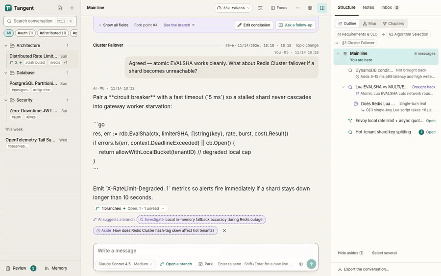
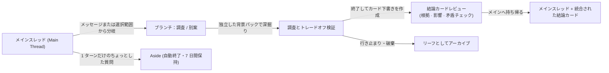
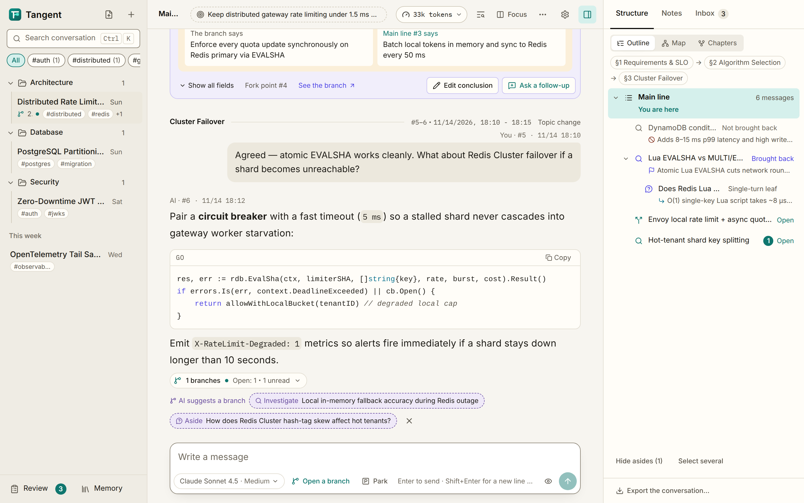
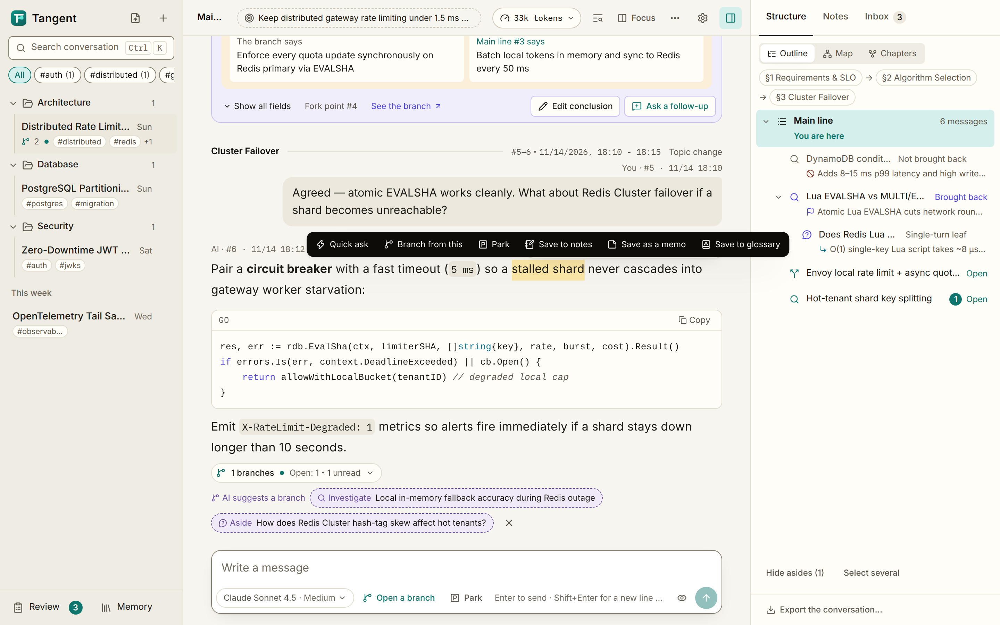
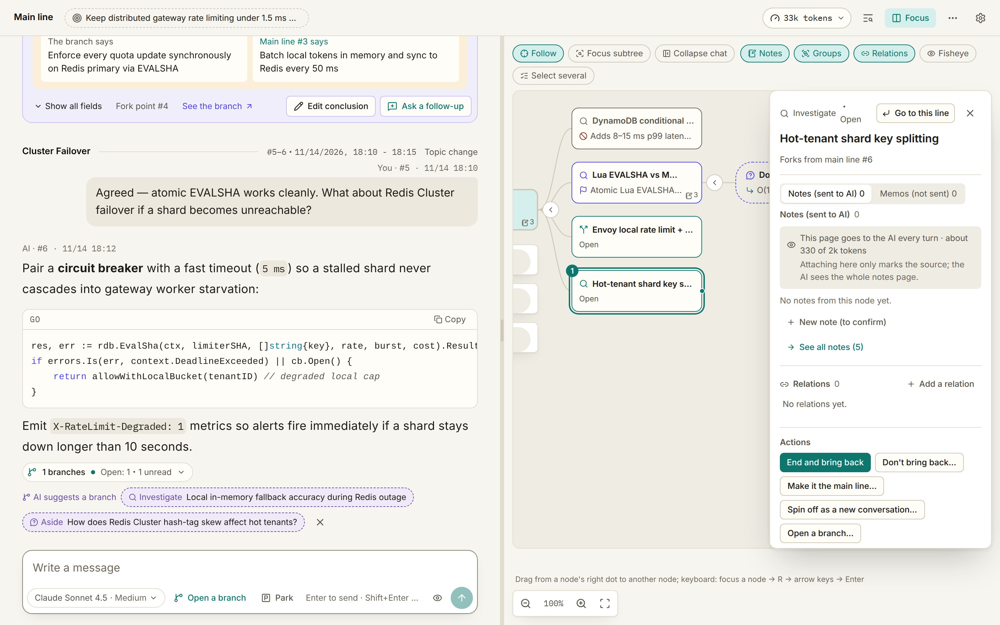
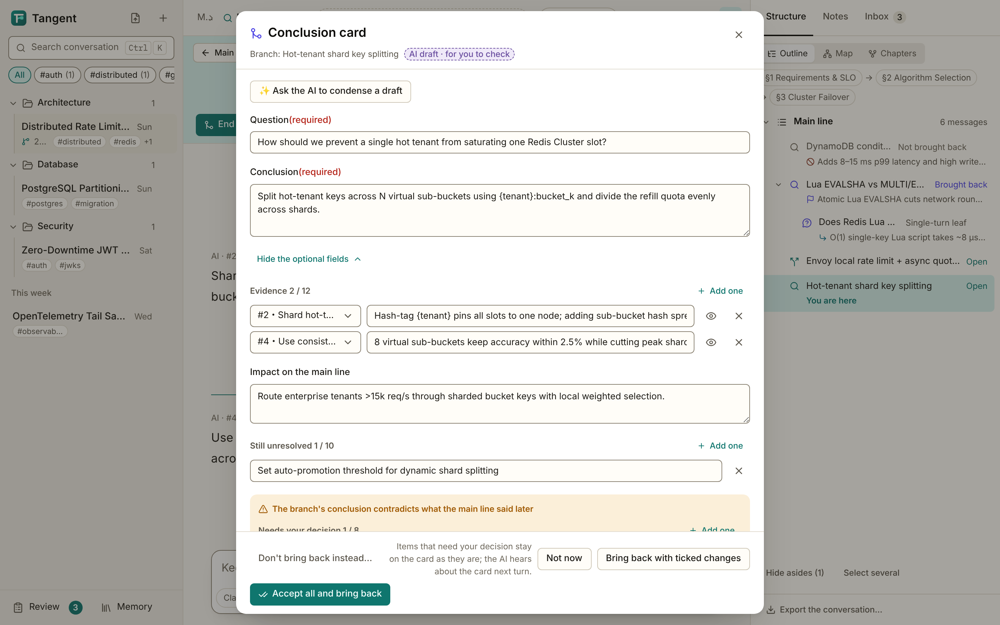
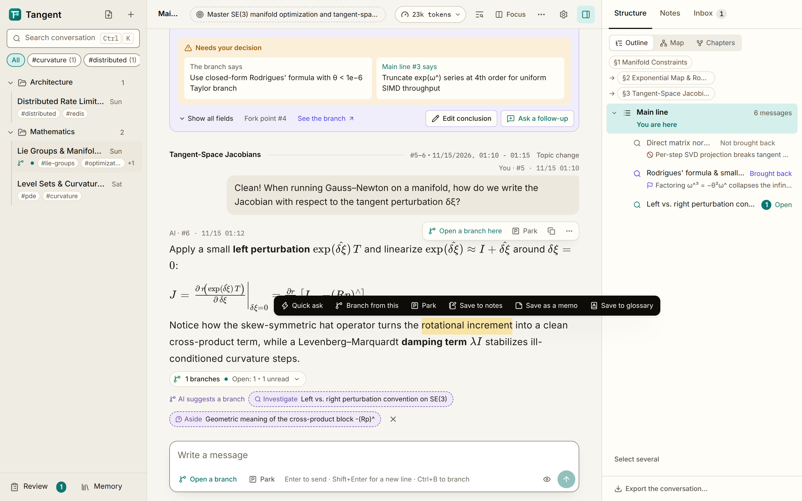
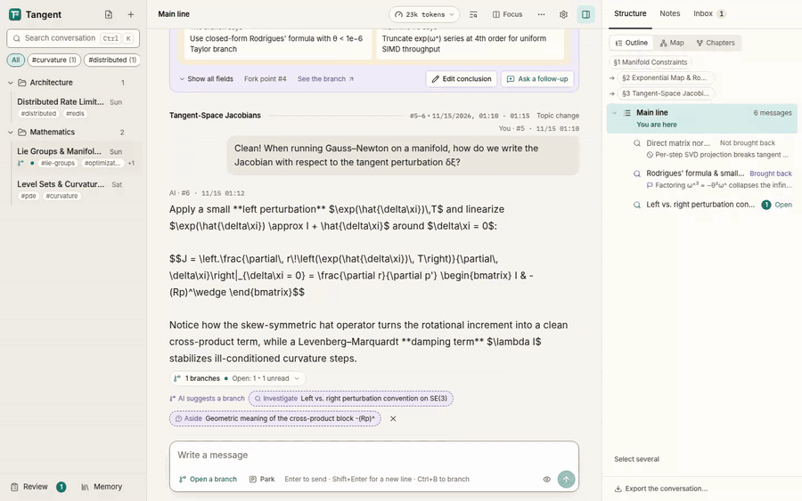
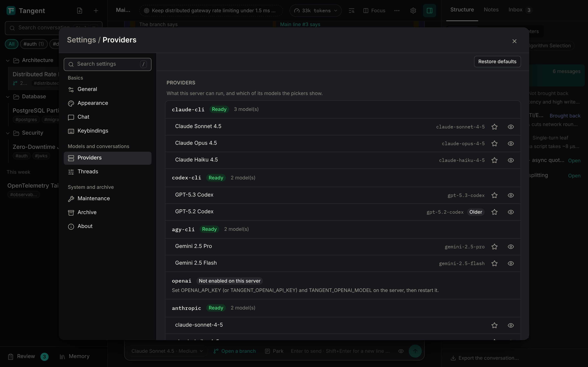
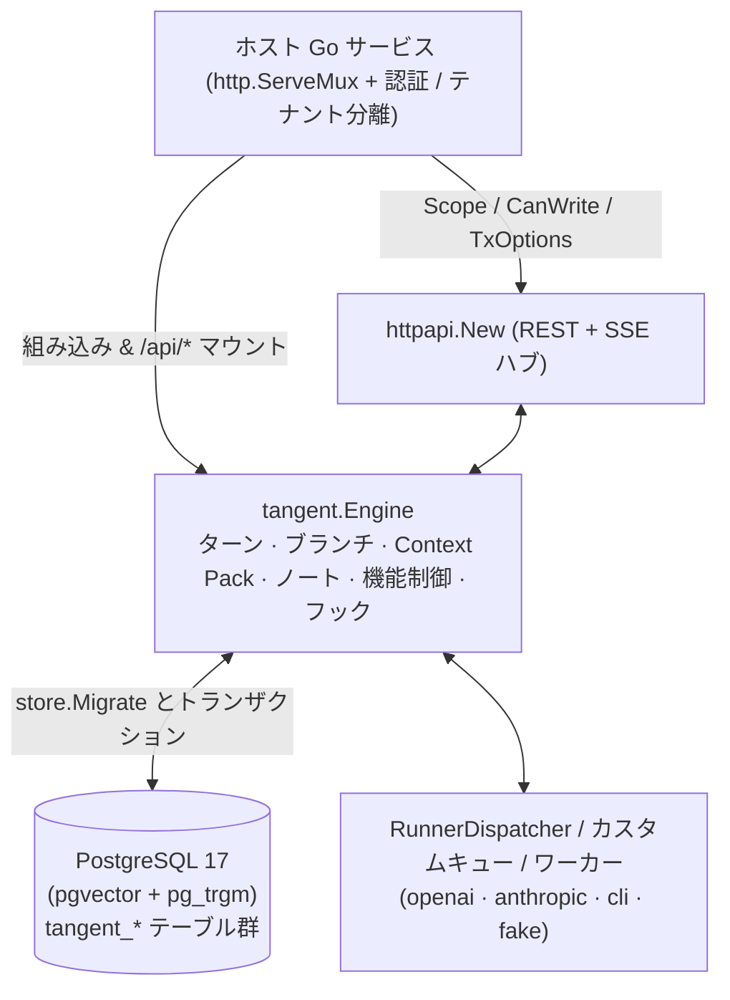

[English](README.md) · [繁體中文](README.zh-TW.md) · [日本語](README.ja.md)

# Tangent

[](https://github.com/Rynvex/tangent/actions/workflows/ci.yml)
[](https://github.com/Rynvex/tangent/releases/tag/v0.1.0)
[](https://pkg.go.dev/github.com/Rynvex/tangent)
[](go.mod)
[](LICENSE)

Go サービスに組み込み可能なセルフホスト対応**分岐型 AI 会話エンジン＆ワークスペース**：任意のメッセージから**ブランチ（Branch）**を分岐して脇道の調査や別案の比較を行い、出典リンクや矛盾チェック付きの**結論カード（Conclusion Card）**をレビューしてメインスレッドへ統合、完了したブランチは**リーフ（Leaf）**としてアーカイブできます。

スタンドアロンのリファレンスサーバー（`cmd/tangent-server`）を同梱しており、OpenAI 互換 API・Anthropic API に加え、API キー不要の**ローカル CLI サブスクリプション**（`claude`、`codex`、`agy`）や、多言語対応のレスポンシブ React Web UI（`English`、`繁體中文`、`日本語`）を備えています。



---

## ドキュメント

- [設計とコントラクト](docs/DESIGN.md) · [ロードマップ](docs/ROADMAP.md) · [組み込みガイド](docs/EMBEDDING.md) · [HTTP API リファレンス](docs/API.md) · [開発ログ](docs/devlog/) · [変更履歴](CHANGELOG.md)（`v0.1.0`）

## 目次

1. [なぜ Tangent なのか？](#なぜ-tangent-なのか)
2. [コアコンセプトとワークフロー](#コアコンセプトとワークフロー)
3. [ワークスペースツアー](#ワークスペースツアー)
4. [5 分クイックスタート](#5-分クイックスタート)
5. [モデルプロバイダーの選択](#モデルプロバイダーの選択)
6. [ローカル CLI サブスクリプションとセキュリティサンドボックス](#ローカル-cli-サブスクリプションとセキュリティサンドボックス)
7. [Web UI：モデル・多言語・設定・ショートカット](#web-uiモデル多言語設定ショートカット)
8. [Go サービスへの組み込み](#go-サービスへの組み込み)
9. [開発・CI コマンド](#開発ci-コマンド)
10. [著者とライセンス](#著者とライセンス)

---

## なぜ Tangent なのか？

従来の線形 AI チャットでは、途中で疑問を掘り下げたり別案を比較したり数式を確認したりすると、**コンテキスト汚染（Context Rot）**が起きて本筋を見失いがちです。Tangent は会話を**分離・統合可能なツリー**として扱います：

| 従来の線形 AI チャット | Tangent |
|---|---|
| 脇道の質問でメインのコンテキストとトークンが圧迫される | **ブランチ分離**：トークン予算に基づく Context Pack で調査・別案・単発 Aside を分離 |
| 後からスクロールして結論を自力で整理する必要がある | **結論カード**：AI が根拠・影響・矛盾点を含む要約下書きを作成し、レビュー後にメインへ統合 |
| 長い会話や過去知識がフラットな履歴に埋もれる | **フォーカスマップ・共有メモ・`pgvector` 記憶**：ツリー全体を俯瞰し、スレッド横断で事実を想起 |
| 既存バックエンドへの組み込みが大変 | **組み込み可能な Go + PostgreSQL + React**：`httpapi` を既存サービスにマウント可能 |

### 主なユースケース

- **システム設計・アーキテクチャ検討**：複数の設計案（例：Redis レート制限 vs ローカルフォールバック）を並列ブランチで検証し、確定事項だけをメイン仕様へ統合。
- **数学学習・KaTeX 数式導出**：証明や式のステップをドラッグ選択して、導出の本筋を崩さずに定義の確認や用語集への保存が可能。
- **既存チャット履歴のインポート・構造化**：ChatGPT / Gemini のエクスポートを取り込み、時系列や AI 分析でチャプターとブランチツリーへ自動再構成。
- **Go + PostgreSQL ベースの AI アプリ開発**：トランザクション保証された会話ツリー、SSE ストリーミング、OpenAI / Anthropic / CLI ランナーをすぐに組み込み可能。

---

## コアコンセプトとワークフロー

長い会話の途中で技術的なトレードオフや脇道の疑問が生じたとき、Tangent はメインスレッドの文脈を汚染せずに思考を整理します：

- **ツリー構造の会話ブランチ**：任意のメッセージまたは選択テキストから **調査（Investigate）**、**別案（Alternative）**、あるいは 1 ターン限りの **寄り道メモ（Aside）** ブランチを作成できます。各ブランチはトークン予算に沿って抽出された親スレッドの**背景コンテキストパック（Context Pack）**を受け取ります。
- **構造化された結論カード（Conclusion Card）**：ブランチで結論が出たら、AI が「問い・結論・根拠となる発言への引用・メインスレッドへの影響・未解決事項・後続発言との矛盾」をまとめたカード下書きを生成し、レビュー後にメインスレッドへ持ち帰ることができます。
- **リーフアーカイブ（Leaf）**：終了したブランチは簡潔な**リーフ**（`conclusion` / `dead_end` / `answer`）として記録され、構成アウトラインやインタラクティブマップからいつでも参照できます。
- **共有メモ・チャプター・フォーカスマップ**：会話ツリー全体で共有されるノート（決定事項 / 確認済み事実 / 要確認 / ToDo）、自動・手動チャプター区切り、個人用の**メモ（Memo）**・**用語集（Glossary）**・**シード（Seed）**、そして会話とツリー図を並べて表示する**フォーカスモード**を備えています。



---

## ワークスペースツアー

### 例 1：システム設計・開発（`Distributed Rate Limiter Design`）

#### メインワークスペース・結論カード・構成アウトライン



#### テキスト選択フローティング操作バー

メッセージ内の語句をドラッグして選択すると、「クイック質問」「ここからブランチ」「保留」「ノートに保存」「メモとして保存」「用語集に保存」がその場でポップアップ表示されます：



#### フォーカスモード：会話とインタラクティブツリーマップの分割表示



#### 結論カードのレビューと統合



### 例 2：数学学習・数式導出（`Lie Groups & Manifold Optimization`）

KaTeX による数式レンダリングとテキスト選択操作の組み合わせです。数式や導出ステップをドラッグ選択するだけで、証明の深掘りブランチや用語集への保存をその場で実行でき、学習の本筋を遮りません。





---

## 5 分クイックスタート

**動作要件**：Go `1.26+`、Docker（`pgvector` と `pg_trgm` を含む PostgreSQL 17 用）、および Node `22` + pnpm `9`（Web UI の起動・ビルド時のみ必要）。

```bash
# 1. PostgreSQL 17 + pgvector を 127.0.0.1:5444 で起動（tangent / tangent_test DB を作成）
make db-up            # docker compose up -d --wait postgres と同等

# 2. 環境設定（.env.example の初期値はシナリオ A：TANGENT_DEV=1 のモック応答モード）
cp .env.example .env
set -a; . ./.env; set +a

# 3. リファレンスサーバーを http://127.0.0.1:8120 で起動
make serve
```

別ターミナルで Web UI 開発サーバーを起動します（`VITE_TANGENT_API=http` を指定すると `:8120` に接続し、省略するとブラウザ内モックで動作します）：

```bash
pnpm -C web install
VITE_TANGENT_API=http pnpm -C web dev      # http://localhost:5183 で起動し /api を :8120 へプロキシ
```

ブラウザで <http://localhost:5183> を開きます。起動時に `tangent-server` が各プロバイダーの検出結果を表示します：

```text
tangent-server ready
  address    http://127.0.0.1:8120
  access     dev mode: no token, loopback only
  providers
    fake: 1 model
    claude-cli: skipped (claude binary not found)
    codex-cli: skipped (codex binary not found)
    agy-cli: skipped (agy binary not found)
  default    fake:fake-1
  job model  same as the conversation's
  fallback   none
  web ui     not served here; run `VITE_TANGENT_API=http pnpm -C web dev` and open http://localhost:5183
```

利用可能な機能やプロバイダー状態は `GET /api/capabilities` からいつでも確認できます：

```bash
curl http://127.0.0.1:8120/api/capabilities
```

### `tangent-server` からビルド済み Web UI を直接配信する

別途 Vite サーバーを立てず、`:8120` 単体で配信したい場合の手順です：

```bash
VITE_TANGENT_API=http pnpm -C web build
TANGENT_STATIC_DIR=web/apps/demo/dist make serve
```

---

## モデルプロバイダーの選択

[`.env.example`](.env.example) には用途別の 4 つのシナリオ（**A〜D**）が用意されており、すべて環境変数で切り替えられます：

| シナリオ | 必要な準備 | 主な環境変数 |
|---|---|---|
| **A. キーレスお試し** | 追加ツール・キー不要 | `TANGENT_DEV=1`（モック応答、`127.0.0.1` 限定バインド、トークン不要） |
| **B. Claude Code サブスクリプション** | `claude login` を一度実行 | `TANGENT_TOKEN`、`TANGENT_PROVIDER=claude-cli`、`TANGENT_CLAUDE_CLI_MODEL=sonnet` |
| **C. Claude CLI + Codex CLI** | `codex login` も実行 | 上記 + `TANGENT_CODEX_CLI_MODEL=<model>`、任意で `TANGENT_FALLBACK_MODEL=codex-cli:<model>` |
| **D. API プロバイダー** | OpenAI 互換または Anthropic キー | `TANGENT_PROVIDER=openai` + `OPENAI_API_KEY` + `TANGENT_MODEL`（または `anthropic` + `ANTHROPIC_API_KEY`） |

- **`TANGENT_TOKEN`**：`TANGENT_DEV=1` 以外では必須（32 文字以上、例：`openssl rand -hex 32`）。クライアントは `Authorization: Bearer <token>` で認証します。
- **ローカル vs 外部バインド**：シナリオ B〜D はデフォルトで全インターフェースの `:8120` を待機します。ローカル専用にする場合は `TANGENT_ADDR=127.0.0.1:8120` を設定してください。トークン保護されたサーバーに Vite dev サーバーを接続する場合は `TANGENT_API_TOKEN=<token>` を渡し、Tailscale やリバースプロキシ越しにアクセスする場合は `VITE_ALLOWED_HOSTS=.ts.net` を設定します。
- **その他の主な環境変数**（詳細は [`.env.example`](.env.example) を参照）：
  - `TANGENT_JOB_MODEL=provider:model`：バックグラウンド処理（ローリング要約・結論カード下書き）専用モデル。対話は CLI サブスクリプション、バックグラウンドは低コスト API モデルといった使い分けが可能です。
  - `TANGENT_FALLBACK_MODEL=provider:model`：ストリーム開始前にレート制限やクォータエラーが起きた際、自動的に 1 回リトライする代替モデル。
  - `TANGENT_ALLOWED_MODELS=provider:model,...`：**厳格な許可リスト**を有効にします（組み込みカタログやエイリアスは無効）。未指定時は設定済みモデルと各 CLI の組み込みモデル一覧を公開します。
  - `TANGENT_FEATURES`：機能プリセット（既定値 `standard`、ほか `essential` / `full`）またはカンマ区切りの `feature[:mode]`。
  - `TANGENT_DATABASE_URL`：既定では Docker Compose で起動した `:5444` の PostgreSQL に接続します。

---

## ローカル CLI サブスクリプションとセキュリティサンドボックス



リファレンスサーバーは、ローカルで認証済みの AI CLI を API キー不要のプロバイダーとしてラップできます：

| プロバイダー | 既定の実行ファイル | 認証手順 | パス / モデル / 同時実行数の環境変数 |
|---|---|---|---|
| `claude-cli` | `claude` | `claude login` | `TANGENT_CLAUDE_CLI_PATH` / `_MODEL` / `_MAX_CONCURRENT` |
| `codex-cli` | `codex` | `codex login` | `TANGENT_CODEX_CLI_PATH` / `_MODEL` / `_MAX_CONCURRENT` |
| `agy-cli` | `agy` | Antigravity CLI ログイン | `TANGENT_AGY_CLI_PATH` / `_MODEL` / `_MAX_CONCURRENT` |

- **自動検出**：`TANGENT_CLI_AUTODETECT=1`（`TANGENT_DEV=1` 時は既定で有効、それ以外は無効）により、起動時に `PATH` から `claude`・`codex`・`agy` を検索します。見つからない CLI は `skipped` として記録され、`/api/capabilities` 上では `ready: false` となり起動を妨げません。
- **組み込みモデルカタログと推論レベル（Effort）**：Web UI からモデルと推論レベル（`low` / `medium` / `high` / `max` / `xhigh`）を選択でき、サーバーは対象モデルが対応している場合のみ Effort フラグを付与します。
- **厳格な実行サンドボックス**：各ターンはチャット専用モードの隔離されたサブプロセスで実行されます——**すべてのツール無効**、作業ディレクトリは**空の一時ディレクトリ**、プロンプトは `stdin` 経由でのみ渡されます。環境変数は厳格なホワイトリスト（`PATH`、`HOME`、ロケール、プロキシ/CA 証明書、CLI 固有の設定変数のみ）で制限され、`TANGENT_CLI_ENV` による追加指定でも `TANGENT_*`・`*DATABASE_URL*`・`*API_KEY*` は拒否されます。
- **利用上の注意**：CLI サブスクリプションは個人利用を想定しています。要約やカード下書きなどの自動バックグラウンド処理には `TANGENT_JOB_MODEL` で API モデルを指定することを推奨します。

---

## Web UI：モデル・多言語・設定・ショートカット

- **多言語 UI（遅延ロード）**：**English (`en`)**、**繁體中文 (`zh-TW`)**、**日本語 (`ja`)** を完全サポート。言語辞書と CJK フォントはオンデマンドで読み込まれるため、初期バンドルサイズを軽量に保ちます。**設定 → 一般** からリアルタイムに切り替えられるほか、`?lang=en|zh-TW|ja` でも指定できます。
- **モデルピッカー＆検索可能な設定画面**：コンポーザーからスレッド・ブランチごとにモデルと推論レベルを選択でき、お気に入り登録・レガシーモデルの非表示・`/` による設定検索・設定の JSON エクスポート／インポートに対応しています。
- **既定のキーボードショートカット**（macOS では `Mod` = `Cmd`、その他は `Ctrl`。**設定 → キー割り当て** から変更可能）：

| ショートカット | 操作 |
|---|---|
| `Mod+K` | コマンドパレットを開く |
| `Mod+B` | 選択中のテキストからブランチを開く |
| `Mod+Enter` | ブランチを終了して結論カードを持ち帰る |
| `Mod+[` | メインスレッドへ戻る |
| `Mod+F` | 会話ツリー内を検索 |
| `Mod+Shift+M` | 構成ビュー切り替え（アウトライン / マップ） |
| `Mod+Shift+F` | フォーカスモード切り替え |
| `Mod+.` | サイドバーの折りたたみ / 展開 |
| `Shift+?` | ショートカット一覧を表示 |

---

## Go サービスへの組み込み

既存の `pgxpool.Pool` を用意し、`store.Migrate` → `tangent.New` → `httpapi.New` の順に初期化してルーターへマウントするだけで導入できます。AI ターンの実行方式（直接 API 呼び出し・独自キュー・リモートワーカー）はホスト側で自由に制御できます。



最小構成の組み込み例（[`examples/embedding/minimal.go`](examples/embedding/minimal.go) を参照）：

```go
if err := store.Migrate(ctx, pool); err != nil {
	return nil, err
}
engine, err := tangent.New(pool, tangent.WithFeatures(tangent.AllFeatures()...))
if err != nil {
	return nil, err
}
dispatcher := tangent.NewRunnerDispatcher(engine, fake.New(fake.Config{}))
api, err := httpapi.New(httpapi.Config{
	Engine:     engine,
	Dispatcher: dispatcher,
	Scope:      func(*http.Request) (tangent.Scope, error) { return tangent.Scope{Tenant: "demo"}, nil },
})
mux.Handle("/api/", http.StripPrefix("/api", api))
```

### パッケージ構成と統合ドキュメント

- **組み込みガイド**：[`docs/EMBEDDING.md`](docs/EMBEDDING.md)（最小導入・機能トグル・Dispatcher・ホストフック・認証とテナント分離・マイグレーションとアップグレード規約——[`examples/embedding/`](examples/embedding/) のテスト済みコードと連動）
- **HTTP API リファレンス**：[`docs/API.md`](docs/API.md)（全エンドポイント・エラーコード・SSE イベント仕様）
- **実行可能なホスト例**：[`examples/minimal-host/`](examples/minimal-host/)（独自ルート・SHA-256 API キー認証・SSE・メンテナンスループ・`:8122` 上の `fake` ランナー）
- **主要パッケージ**：`domain`、`store`、`tangent`、`httpapi`、`runner/openai`、`runner/anthropic`、`runner/cli`、`runner/fake`、`tangenttest`、`web/packages/{client,react,fonts}`

Go 以外のサービスからは `cmd/tangent-server` を起動して HTTP + SSE 経由で利用できます。

---

## 開発・CI コマンド

```bash
make db-up        # :5444 で PostgreSQL 17 + pgvector を起動
make vet          # go vet ./...
make test         # go test ./... -count=1（DB に接続できない場合は DB テストを自動スキップ）
make check        # vet + Go テスト + Web typecheck / vitest / build
make serve        # :8120 でリファレンスサーバーを起動
pnpm -C web typecheck
(cd web/packages/react && npx vitest run)   # パッケージ単体のユニットテストを実行
```

CI（[`.github/workflows/ci.yml`](.github/workflows/ci.yml)）ではプッシュとプルリクエストごとに、Go の `vet`＆テスト（PostgreSQL 17 + `pgvector`）、Web `typecheck`、各パッケージの Vitest（`fonts`、`client`、`react`、`demo`）、2 種類のビルド（モックおよび `VITE_TANGENT_API=http`）、ならびにメイン JS の gzip バンドルサイズ上限チェック（172 kB / 185 kB）を実行します。

**デフォルトポート**：PostgreSQL `5444` · リファレンスサーバー `8120` · Web 開発サーバー `5183`

---

## 著者とライセンス

- **著者**：[@Rynvex](https://github.com/Rynvex)
- **ライセンス**：MIT — [LICENSE](LICENSE) を参照してください。
