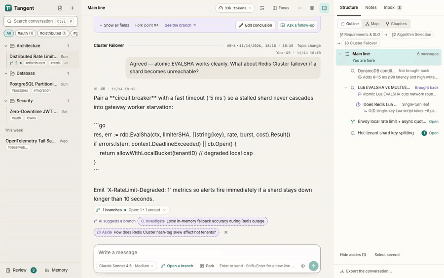
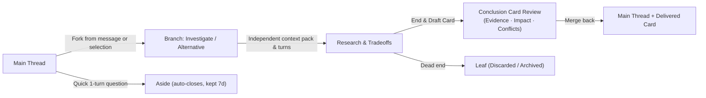
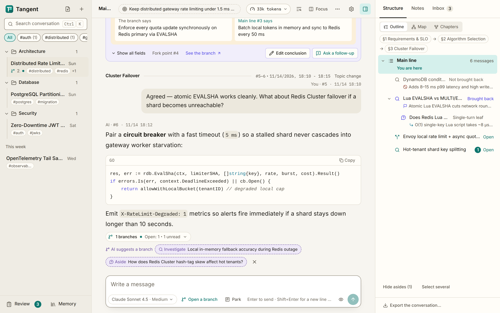
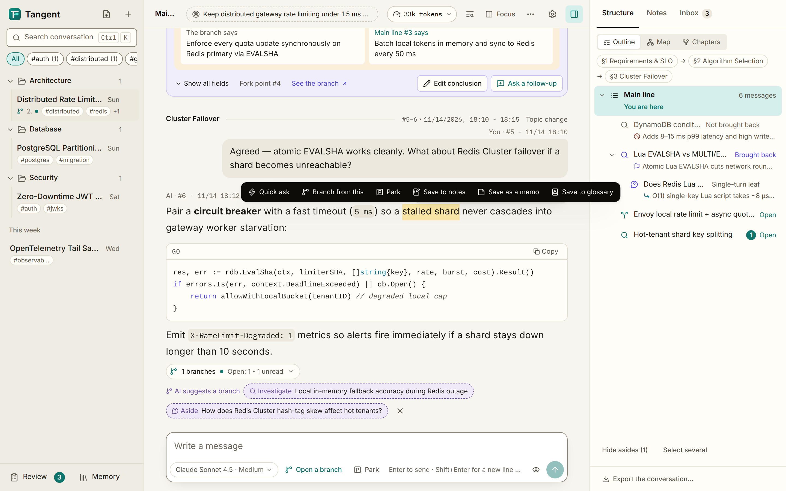
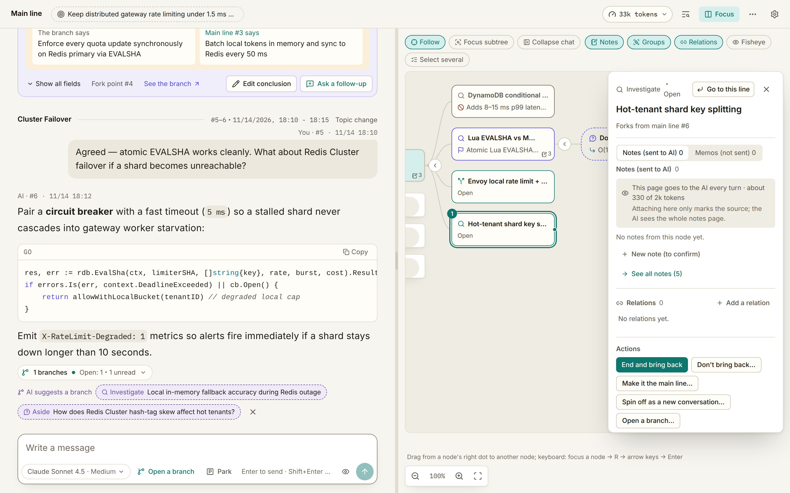
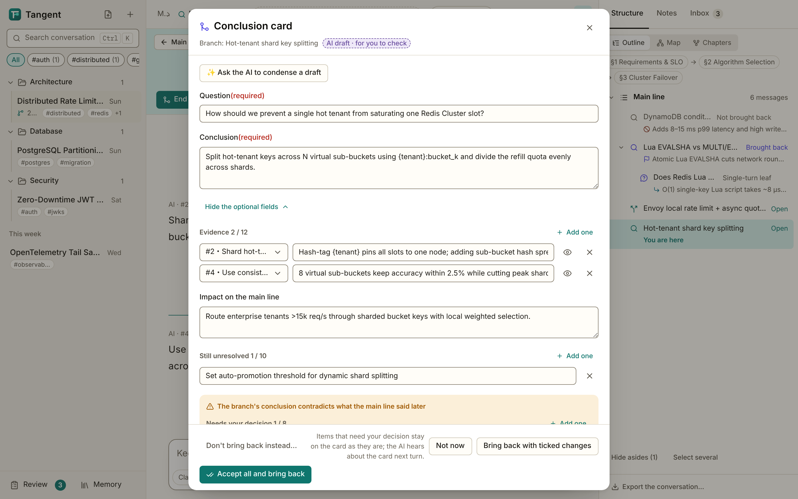
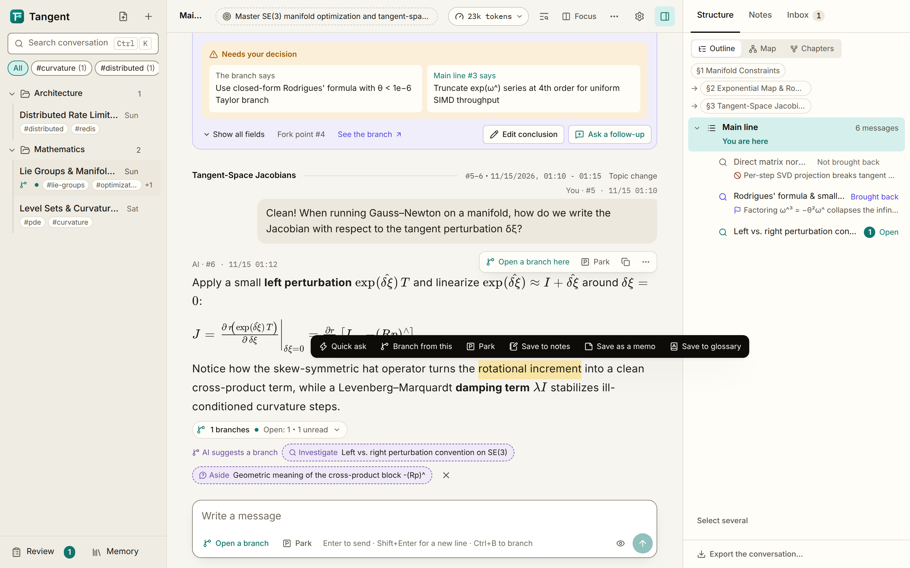
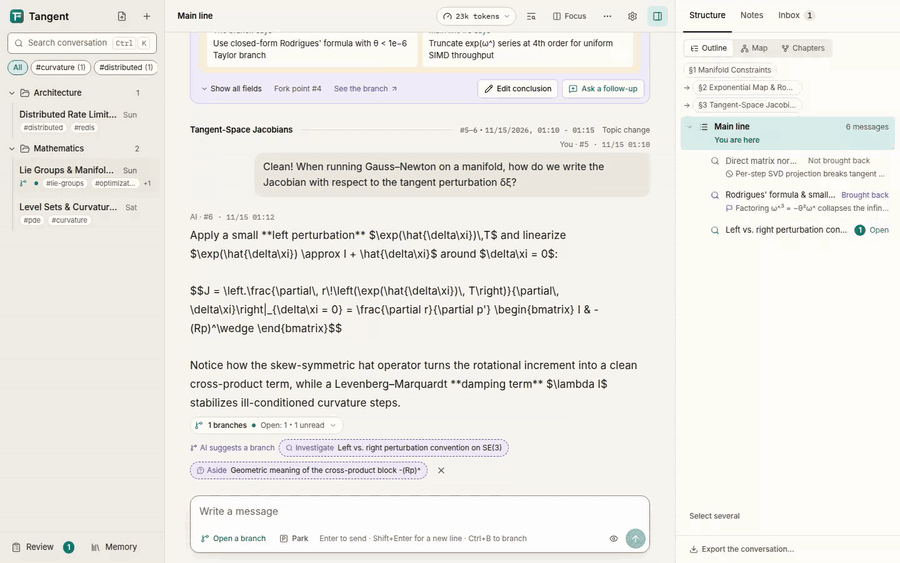
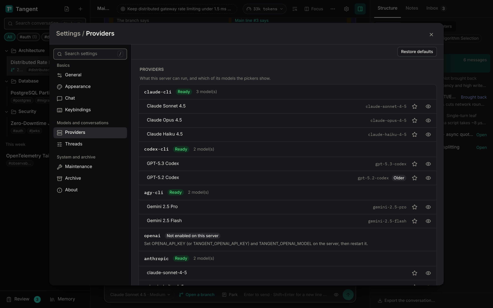
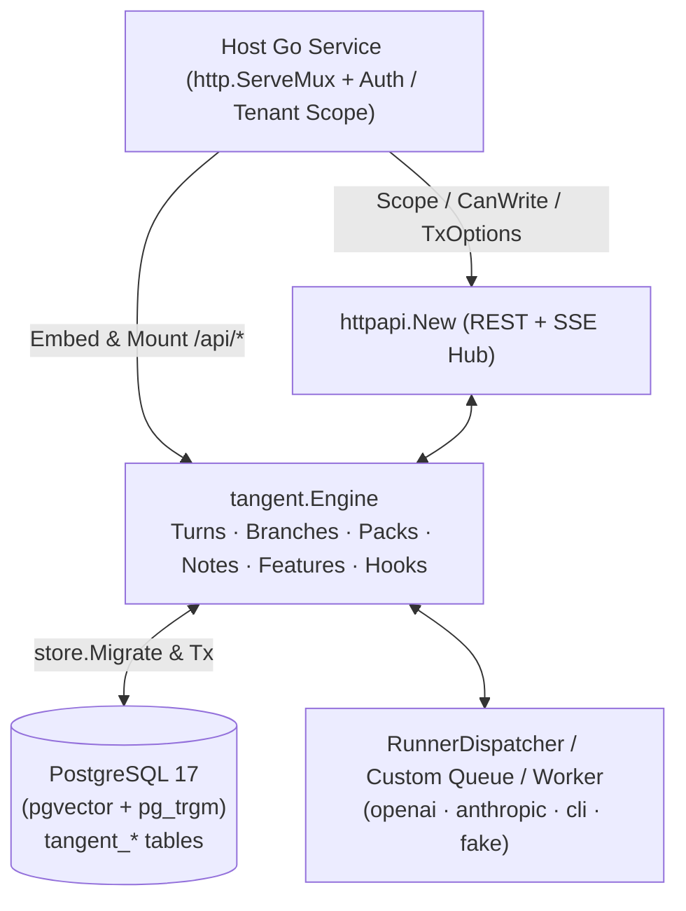

[English](README.md) · [繁體中文](README.zh-TW.md) · [日本語](README.ja.md)

# Tangent

[](https://github.com/Rynvex/tangent/actions/workflows/ci.yml)
[](https://github.com/Rynvex/tangent/releases/tag/v0.1.0)
[](https://pkg.go.dev/github.com/Rynvex/tangent)
[](go.mod)
[](LICENSE)

An embeddable Go library and self-hosted workspace for **branching AI conversations**: fork a **branch** from any message to investigate a side question, review and merge a structured **Conclusion Card** (with evidence links and conflict markers) back into the main thread, and archive closed threads as **Leaves**.

Ships with a standalone reference server (`cmd/tangent-server`) supporting OpenAI-compatible APIs, Anthropic API, and **local CLI subscriptions** (`claude`, `codex`, `agy`) without needing API keys, plus a responsive React Web UI (`English`, `繁體中文`, `日本語`).



---

## Documentation

- [Design & Contract](docs/DESIGN.md) · [Roadmap](docs/ROADMAP.md) · [Embedding Guide](docs/EMBEDDING.md) · [HTTP API Reference](docs/API.md) · [Devlogs](docs/devlog/) · [Changelog](CHANGELOG.md) (`v0.1.0`)

## Table of Contents

1. [Why Tangent?](#why-tangent)
2. [Core Concepts & Workflow](#core-concepts--workflow)
3. [Workspace Tour](#workspace-tour)
4. [5-Minute Quickstart](#5-minute-quickstart)
5. [Choosing a Model Provider](#choosing-a-model-provider)
6. [CLI Subscription Support & Security Sandbox](#cli-subscription-support--security-sandbox)
7. [Web UI: Models, i18n, Settings & Shortcuts](#web-ui-models-i18n-settings--shortcuts)
8. [Embedding into Your Go Service](#embedding-into-your-go-service)
9. [Development & CI Commands](#development--ci-commands)
10. [Author & License](#author--license)

---

## Why Tangent?

Traditional linear AI chats suffer from **context rot** whenever you ask a clarifying question, explore an alternative architecture, or verify a math derivation mid-thread. Tangent treats conversations as **isolated, mergeable trees**:

| Linear AI Chat | Tangent |
|---|---|
| Side questions pollute the main prompt and waste tokens | **Branch isolation**: fork `Investigate`, `Alternative`, or single-turn `Aside` with a token-budgeted Context Pack |
| Scrolling back to summarize what a detour decided | **Conclusion Cards**: AI drafts evidence-backed conclusions and detects contradictions with the main line |
| One-off chats vanish into flat history lists | **Focus Map, Shared Notes & `pgvector` Memory**: navigate trees visually, track decisions, and recall facts across threads |
| Hard to integrate into your own backend | **Embeddable Go + Postgres + React**: mount `httpapi` in your Go service or run `cmd/tangent-server` standalone |

### Ideal Use Cases

- **System Architecture & Engineering**: compare tradeoffs (e.g., Redis vs. local fallback, consensus designs) in parallel branches and bring only the final decision back to the main spec.
- **Math Learning & KaTeX Derivations**: highlight any step or equation in a proof to verify definitions, ask quick side questions, or save terms to a glossary without breaking the derivation flow.
- **Long-Thread Import & Topic Reconstruction**: import exported ChatGPT / Gemini logs and auto-organize interleaved turns into structured chapters and branches.
- **Go + PostgreSQL AI Backends**: embed transactional conversation trees, SSE streaming, and OpenAI / Anthropic / CLI runners into your own multi-tenant product.

---

## Core Concepts & Workflow

Instead of derailing a long conversation when a side question or design tradeoff comes up, Tangent keeps context isolated cleanly:

- **Tree-Structured Branching**: Fork `Investigate`, `Alternative`, or single-turn `Aside` branches from any message or text selection. Each branch receives a token-budgeted **Context Pack** of the parent thread without polluting the main prompt.
- **Structured Conclusion Cards**: When a branch settles, AI can draft a **Conclusion Card** (question, conclusion, evidence citations, impact, open items, and claims that contradict the main line) for your review before merging back.
- **Leaf Archival**: Closed branches record a concise **Leaf** (`conclusion`, `dead_end`, or `answer`) visible across the outline and interactive tree map.
- **Shared Notes, Chapters & Focus Map**: Maintain tree-wide `Decided / Confirmed facts / To confirm / To do` notes, automatic/manual chapters, private **Memos**, **Glossary** terms, parked **Seeds**, and a split **Focus Mode** tree map.



---

## Workspace Tour

### Example 1 — System Architecture & Engineering (`Distributed Rate Limiter Design`)

#### Main Workspace, Conclusion Cards & Structure Outline



#### Text-Selection Floating Action Bar

Highlight any phrase inside a message to **Quick ask**, **Branch from this**, **Park** a seed, **Save to notes**, **Save as a memo**, or **Save to glossary** right in context:



#### Focus Mode: Side-by-Side Conversation & Interactive Tree Map



#### Conclusion Card Review & Merge



### Example 2 — Math Learning & Derivations (`Lie Groups & Manifold Optimization`)

KaTeX math rendering paired with mouse-drag selection: highlight any formula term or derivation step to ask a side question, branch off for a proof, or save to the glossary without losing the main derivation thread.





---

## 5-Minute Quickstart

**Prerequisites**: Go `1.26+`, Docker (for PostgreSQL 17 with `pgvector` and `pg_trgm`), and Node `22` + pnpm `9` (only needed to run or build the Web UI).

```bash
# 1. Start PostgreSQL 17 + pgvector on 127.0.0.1:5444 (creates tangent & tangent_test DBs)
make db-up            # equivalent to: docker compose up -d --wait postgres

# 2. Configure environment (.env.example defaults to Scenario A: TANGENT_DEV=1, fake replies)
cp .env.example .env
set -a; . ./.env; set +a

# 3. Start the reference server on http://127.0.0.1:8120
make serve
```

In a second terminal, launch the Web UI dev server (set `VITE_TANGENT_API=http` to talk to `:8120`; omit it to run the in-browser mock):

```bash
pnpm -C web install
VITE_TANGENT_API=http pnpm -C web dev      # http://localhost:5183, proxies /api -> :8120
```

Open <http://localhost:5183>. On startup, `tangent-server` prints a provider readiness summary:

```text
tangent-server ready
  address    http://127.0.0.1:8120
  access     dev mode: no token, loopback only
  providers
    fake: 1 model
    claude-cli: skipped (claude binary not found)
    codex-cli: skipped (codex binary not found)
    agy-cli: skipped (agy binary not found)
  default    fake:fake-1
  job model  same as the conversation's
  fallback   none
  web ui     not served here; run `VITE_TANGENT_API=http pnpm -C web dev` and open http://localhost:5183
```

Inspect available features and ready providers anytime at `GET /api/capabilities`:

```bash
curl http://127.0.0.1:8120/api/capabilities
```

### Serving the Built Web UI Directly from `tangent-server`

To serve the frontend straight from `http://127.0.0.1:8120/` without a separate Vite process:

```bash
VITE_TANGENT_API=http pnpm -C web build
TANGENT_STATIC_DIR=web/apps/demo/dist make serve
```

---

## Choosing a Model Provider

`.env.example` provides four ready-to-use scenarios (**A–D**) controlled entirely via environment variables:

| Scenario | Requirements | Key Environment Variables |
|---|---|---|
| **A. Keyless Tryout** | Nothing | `TANGENT_DEV=1` (mock replies, binds `127.0.0.1` only, no token) |
| **B. Claude Code Subscription** | Run `claude login` once | `TANGENT_TOKEN`, `TANGENT_PROVIDER=claude-cli`, `TANGENT_CLAUDE_CLI_MODEL=sonnet` |
| **C. Claude CLI + Codex CLI** | Also run `codex login` | Above + `TANGENT_CODEX_CLI_MODEL=<model>`, optional `TANGENT_FALLBACK_MODEL=codex-cli:<model>` |
| **D. API Providers** | OpenAI-compatible or Anthropic key | `TANGENT_PROVIDER=openai` + `OPENAI_API_KEY` + `TANGENT_MODEL` (or `anthropic` + `ANTHROPIC_API_KEY`) |

- **`TANGENT_TOKEN`**: Required (at least 32 chars, e.g., `openssl rand -hex 32`) outside `TANGENT_DEV=1`. Clients authenticate via `Authorization: Bearer <token>`.
- **Local vs. Remote Bind**: Scenarios B–D listen on `:8120` across interfaces. Set `TANGENT_ADDR=127.0.0.1:8120` for local-only access. When pairing Vite dev with a token-protected server, pass `TANGENT_API_TOKEN=<token>`. Behind a reverse proxy or Tailscale, set `VITE_ALLOWED_HOSTS=.ts.net`.
- **Other Key Variables** (full reference in [`.env.example`](.env.example)):
  - `TANGENT_JOB_MODEL=provider:model`: Dedicated model for background jobs (rolling summaries, conclusion card drafts), e.g., use a CLI subscription for main chat and a low-cost API model for background jobs.
  - `TANGENT_FALLBACK_MODEL=provider:model`: Automatic single retry target if a turn fails due to rate limits/quota before any text has streamed.
  - `TANGENT_ALLOWED_MODELS=provider:model,...`: Enforces a **strict allowlist** (no built-in list or aliases). Leave unset to expose configured models plus each active CLI's built-in model catalog.
  - `TANGENT_FEATURES`: Feature preset (`standard` default, `essential`, `full`) or comma-separated `feature[:mode]` list.
  - `TANGENT_DATABASE_URL`: Defaults to the Docker Compose PostgreSQL instance on `:5444`.

---

## CLI Subscription Support & Security Sandbox



The reference server can wrap locally authenticated AI CLIs as providers without an API key:

| Provider | Default Binary | Auth Setup | Path / Model / Concurrency Env Vars |
|---|---|---|---|
| `claude-cli` | `claude` | `claude login` | `TANGENT_CLAUDE_CLI_PATH` / `_MODEL` / `_MAX_CONCURRENT` |
| `codex-cli` | `codex` | `codex login` | `TANGENT_CODEX_CLI_PATH` / `_MODEL` / `_MAX_CONCURRENT` |
| `agy-cli` | `agy` | Antigravity CLI login | `TANGENT_AGY_CLI_PATH` / `_MODEL` / `_MAX_CONCURRENT` |

- **Auto-Detection**: `TANGENT_CLI_AUTODETECT=1` (on by default when `TANGENT_DEV=1`, off otherwise) checks `PATH` for `claude`, `codex`, and `agy` at startup. Missing CLIs are logged as `skipped` and reported via `/api/capabilities` (`ready: false`) without blocking startup.
- **Built-in Model Catalog & Reasoning Effort**: Select models and reasoning effort levels (`low` / `medium` / `high` / `max` / `xhigh`) right in the Web UI; the server forwards effort flags only when supported by the target model.
- **Strict Turn Sandbox**: Every turn runs in an isolated subprocess in chat-only mode — **zero tools enabled**, executed in an **empty temporary directory**, with the prompt passed over `stdin`. Environment variables are strictly allowlisted (`PATH`, `HOME`, locale, proxy/CA certs, and CLI-specific config vars). Extra allowlist entries use `TANGENT_CLI_ENV` (`TANGENT_*`, `*DATABASE_URL*`, and `*API_KEY*` are rejected).
- **Usage Notice**: CLI subscriptions are intended for personal use; prefer an API model via `TANGENT_JOB_MODEL` for background summarization and drafting.

---

## Web UI: Models, i18n, Settings & Shortcuts

- **Multilingual UI (Lazy-Loaded)**: Full support for **English (`en`)**, **Traditional Chinese (`zh-TW`)**, and **Japanese (`ja`)**. Locale dictionaries and CJK fonts load on demand so the initial bundle stays lightweight. Switch languages live under **Settings → General**, or override via `?lang=en|zh-TW|ja`.
- **Model Picker & Searchable Settings**: Pick model + reasoning effort per line or branch from the composer toolbar, star favorite models, hide legacy ones, search any setting with `/`, and export/import preferences as JSON.
- **Default Keyboard Shortcuts** (`Mod` = `Cmd` on macOS, `Ctrl` elsewhere; customizable in **Settings → Keybindings**):

| Shortcut | Action |
|---|---|
| `Mod+K` | Command palette |
| `Mod+B` | Open branch from selected text |
| `Mod+Enter` | End branch & bring Conclusion Card back |
| `Mod+[` | Return to main line |
| `Mod+F` | Search within conversation tree |
| `Mod+Shift+M` | Toggle Structure view (Outline / Map) |
| `Mod+Shift+F` | Toggle Focus Mode |
| `Mod+.` | Collapse / expand sidebar |
| `Shift+?` | Show keyboard shortcuts help |

---

## Embedding into Your Go Service

Bring your own `pgxpool.Pool`, run `store.Migrate` → `tangent.New` → `httpapi.New`, and mount the handler onto your router. You control how AI turns execute (direct API runners, your own queue, or remote workers).



Minimal embedding example (see [`examples/embedding/minimal.go`](examples/embedding/minimal.go)):

```go
if err := store.Migrate(ctx, pool); err != nil {
	return nil, err
}
engine, err := tangent.New(pool, tangent.WithFeatures(tangent.AllFeatures()...))
if err != nil {
	return nil, err
}
dispatcher := tangent.NewRunnerDispatcher(engine, fake.New(fake.Config{}))
api, err := httpapi.New(httpapi.Config{
	Engine:     engine,
	Dispatcher: dispatcher,
	Scope:      func(*http.Request) (tangent.Scope, error) { return tangent.Scope{Tenant: "demo"}, nil },
})
mux.Handle("/api/", http.StripPrefix("/api", api))
```

### Package Overview & Integration Docs

- **Embedding Guide**: [`docs/EMBEDDING.md`](docs/EMBEDDING.md) (minimal setup, feature toggles, dispatchers, host hooks, auth/tenancy, migrations, upgrade rules — backed by tested code in [`examples/embedding/`](examples/embedding/))
- **HTTP API Reference**: [`docs/API.md`](docs/API.md) (every route, error code, and SSE event)
- **Runnable Example Host**: [`examples/minimal-host/`](examples/minimal-host/) (custom routes, SHA-256 API-key auth, SSE, maintenance loop, `fake` runner on `:8122`)
- **Core Packages**: `domain`, `store`, `tangent`, `httpapi`, `runner/openai`, `runner/anthropic`, `runner/cli`, `runner/fake`, `tangenttest`, and `web/packages/{client,react,fonts}`

Non-Go services can run `cmd/tangent-server` over HTTP + SSE.

---

## Development & CI Commands

```bash
make db-up        # Start PostgreSQL 17 + pgvector on :5444
make vet          # go vet ./...
make test         # go test ./... -count=1 (DB tests skip if Postgres is unreachable)
make check        # vet + Go tests + Web typecheck / vitest / build
make serve        # Run reference server on :8120
pnpm -C web typecheck
(cd web/packages/react && npx vitest run)   # Run package suites individually
```

CI ([`.github/workflows/ci.yml`](.github/workflows/ci.yml)) runs on pushes and pull requests: Go `vet` & `test` (with Postgres 17 + `pgvector`), Web `typecheck`, per-package Vitest suites (`fonts`, `client`, `react`, `demo`), both builds (mock and `VITE_TANGENT_API=http`), and main JS gzip bundle size budgets (172 kB / 185 kB).

**Default Ports**: PostgreSQL `5444` · Reference Server `8120` · Web Dev Server `5183`

---

## Author & License

- **Author**: [@Rynvex](https://github.com/Rynvex)
- **License**: MIT — see [LICENSE](LICENSE).
