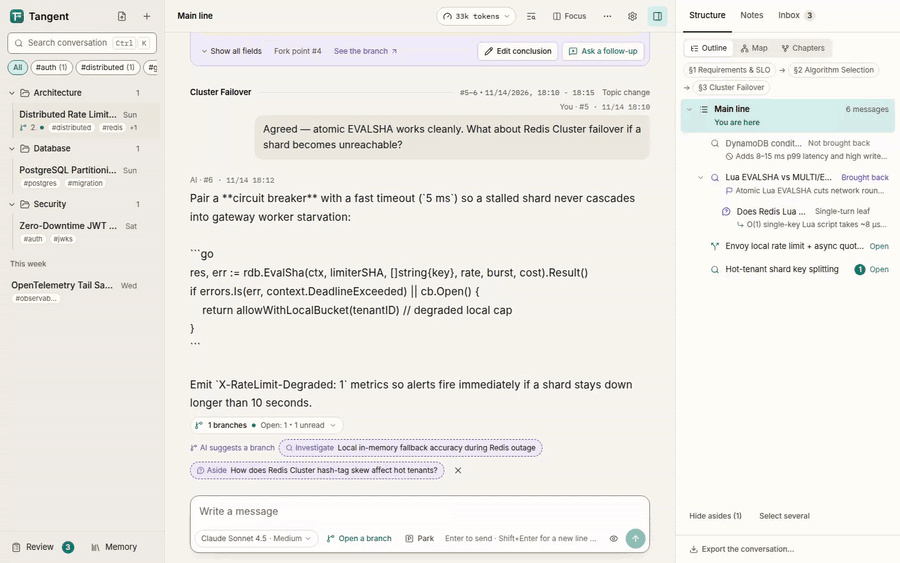
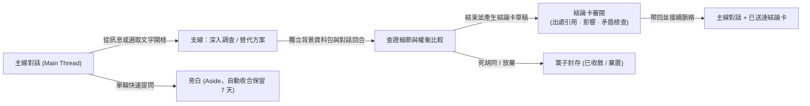
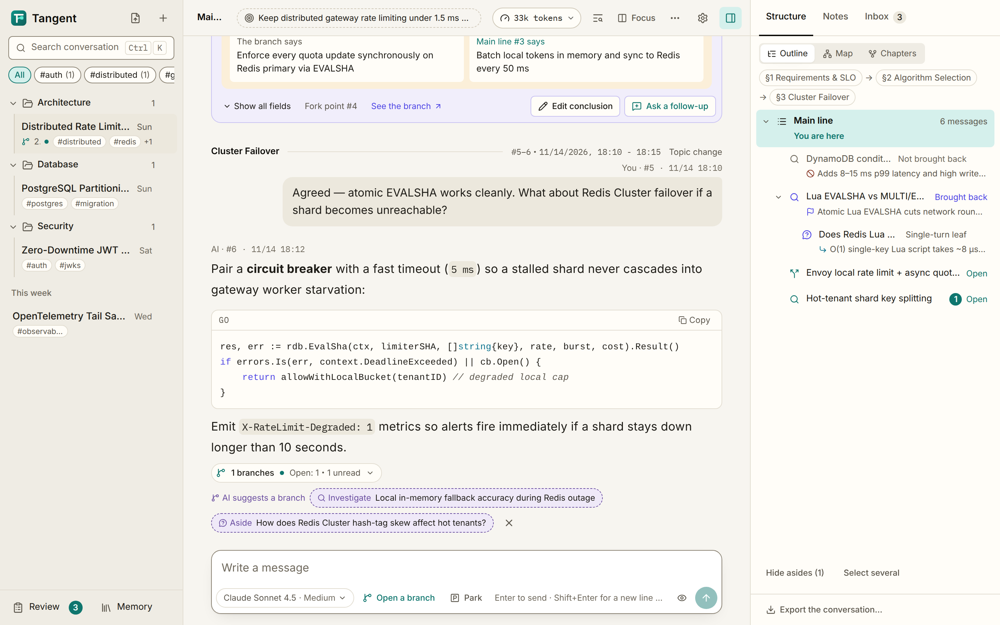
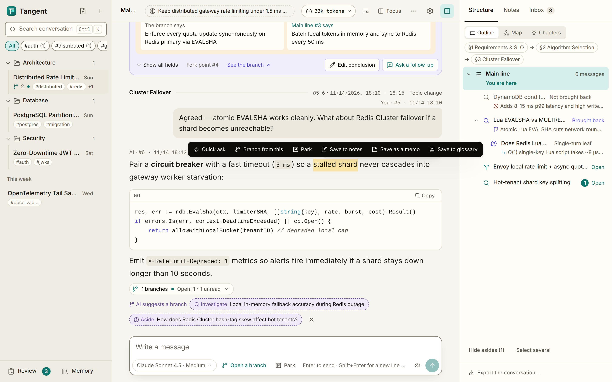
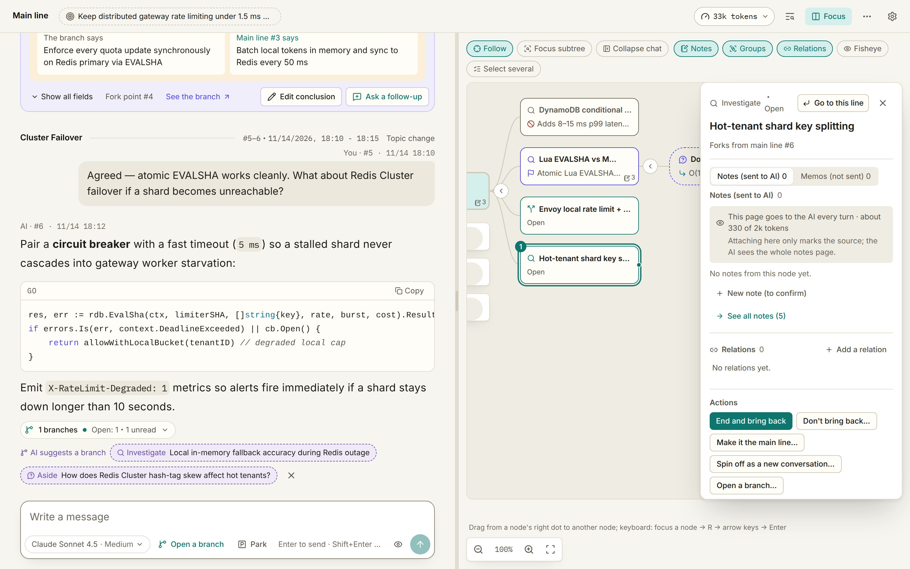
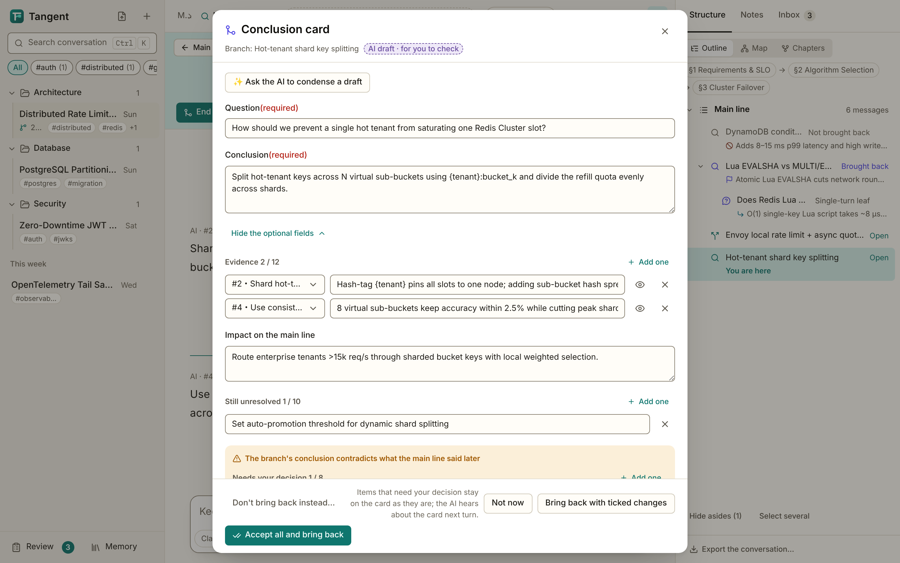
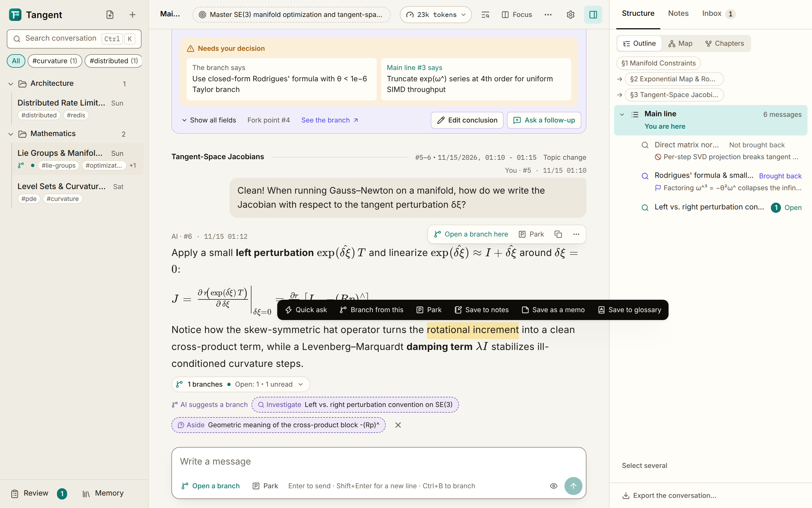
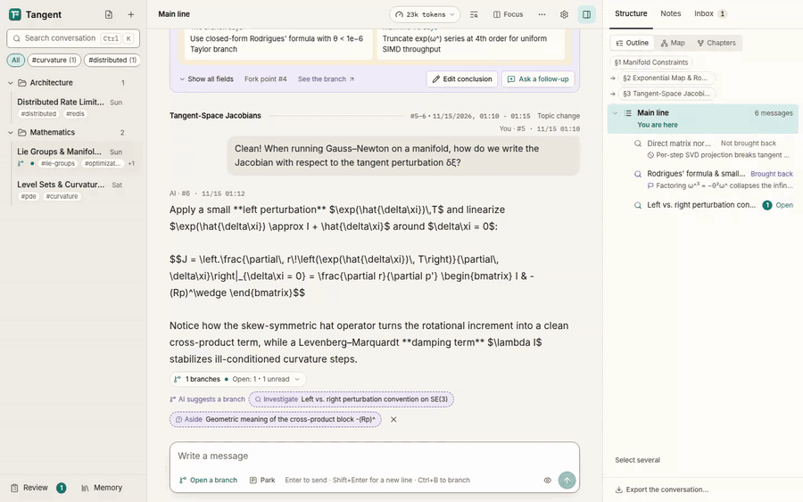
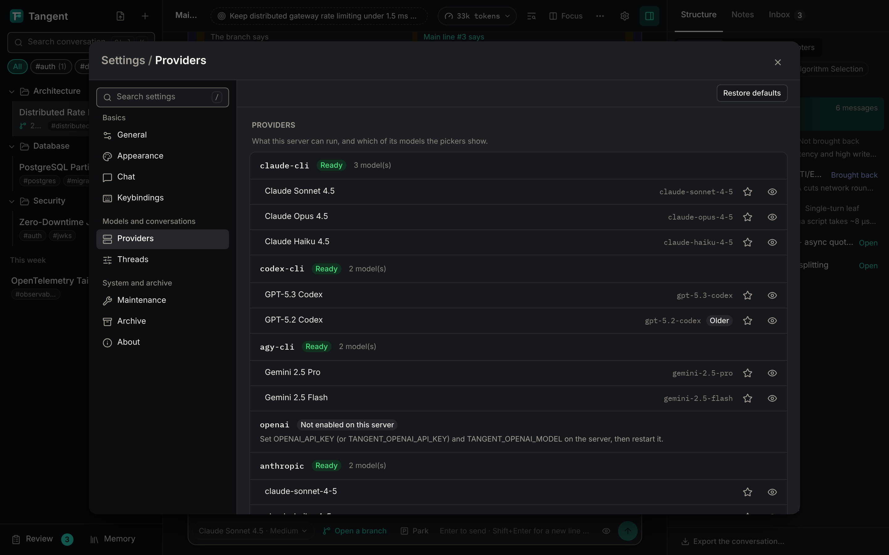
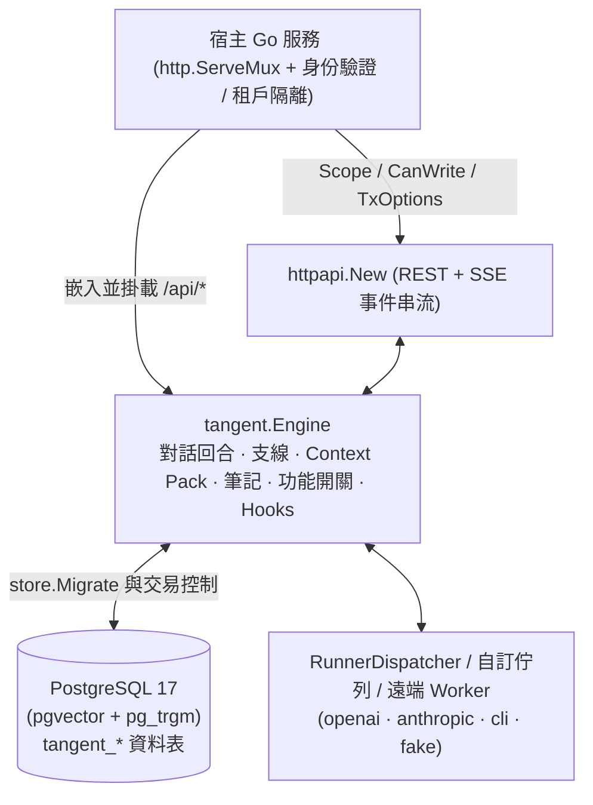

[English](README.md) · [繁體中文](README.zh-TW.md) · [日本語](README.ja.md)

# Tangent

[](https://github.com/Rynvex/tangent/actions/workflows/ci.yml)
[](https://github.com/Rynvex/tangent/releases/tag/v0.1.0)
[](https://pkg.go.dev/github.com/Rynvex/tangent)
[](go.mod)
[](LICENSE)

可嵌入 Go 服務且支援自架的**分支式 AI 對話引擎與工作區**：從任意訊息開出**支線（Branch）**深入查證或比較替代方案，將 AI 濃縮後的結構化**結論卡（Conclusion Card）**（含出處引用與矛盾標記）審閱後帶回主線，並將結束的支線封存為**葉子（Leaf）**。

內建獨立參考伺服器（`cmd/tangent-server`），除 OpenAI 相容 API 與 Anthropic API 外，亦支援免 API 金鑰、透過**本機 CLI 訂閱**執行（`claude`、`codex`、`agy`），並附帶多語系響應式 React Web UI（`English`、`繁體中文`、`日本語`）。



---

## 文件索引

- [設計與合約](docs/DESIGN.md) · [開發路線圖](docs/ROADMAP.md) · [嵌入指南](docs/EMBEDDING.md) · [HTTP API 參考](docs/API.md) · [開發日誌](docs/devlog/) · [更新紀錄](CHANGELOG.md)（`v0.1.0`）

## 目錄

1. [為什麼需要 Tangent？](#為什麼需要-tangent)
2. [核心概念與工作流程](#核心概念與工作流程)
3. [介面導覽](#介面導覽)
4. [5 分鐘快速啟動](#5-分鐘快速啟動)
5. [選擇模型提供者（Provider）](#選擇模型提供者provider)
6. [本機 CLI 訂閱與安全沙盒](#本機-cli-訂閱與安全沙盒)
7. [Web UI：模型切換、多語系、設定與快捷鍵](#web-ui模型切換多語系設定與快捷鍵)
8. [嵌入至您的 Go 服務](#嵌入至您的-go-服務)
9. [開發與 CI 指令](#開發與-ci-指令)
10. [作者與授權條款](#作者與授權條款)

---

## 為什麼需要 Tangent？

傳統線性 AI 對話只要在中途追問細節、比較替代架構或查證數學推導步驟，就會造成**脈絡污染（Context Rot）**並讓主線失焦。Tangent 把對話整理為**可隔離、可收斂合併的對話樹**：

| 傳統線性 AI 對話 | Tangent |
|---|---|
| 旁支問題污染主線 Prompt、浪費 Token | **支線隔離**：依 Token 預算裁剪 Context Pack，開出深入調查、替代方案或單輪旁白（Aside） |
| 事後得自己回捲總結討論出什麼結論 | **結構化結論卡**：AI 自動整理出處引用、主線影響與矛盾點，審閱後一鍵帶回主線 |
| 舊對話只能埋在扁平清單裡找不到 | **專注樹狀圖、共享筆記與 `pgvector` 跨對話記憶**：視覺化導覽與跨樹事實召回 |
| 難整合進既有後端產品 | **可嵌入 Go + PostgreSQL + React 套件**：直接掛載 `httpapi` 或獨立執行 `cmd/tangent-server` |

### 適用場景

- **系統規劃與架構設計**：同時開多條支線比較方案權衡（例如 Redis 限流 vs. 本機降級），最後只把定案帶回主線規格。
- **數學學習與公式推導（KaTeX）**：反白推導中的任何式子或術語就能開支線追問證明或存進名詞表，不打斷原本的學習思路。
- **長對話匯入與主題重組**：匯入 ChatGPT / Gemini 歷史對話，依時間序或 AI 主題分析自動整理為章節與支線樹。
- **Go + PostgreSQL AI 應用開發**：現成提供具交易安全保證的對話樹儲存、SSE 串流與 OpenAI / Anthropic / CLI Runner。

---

## 核心概念與工作流程

當長對話中出現旁支疑問、技術權衡或需要補充查證時，Tangent 讓您無需打斷主線脈絡：

- **樹狀對話分支**：從任意訊息或反白選取的文字開出 **深入調查（Investigate）**、**替代方案（Alternative）**，或單輪不擾動主線的 **旁白（Aside）** 支線。每條支線都會取得依 Token 預算裁剪的母線**背景資料包（Context Pack）**，避免主線 Prompt 被無關細節塞滿。
- **結構化結論卡（Conclusion Card）**：支線收斂時，可請 AI 彙整草稿（包含問題、結論、原文出處引用、對主線的影響、待定項目，以及與主線後續內容互相矛盾的點），經人工確認後帶回主線。
- **葉子封存（Leaf）**：結束後的支線會留下精簡的**葉子**摘要（`conclusion` / `dead_end` / `answer`），可在結構大綱與互動樹狀圖中隨時查閱。
- **共享筆記、章節與專注模式樹狀圖**：跨整棵對話樹維護「已決定 / 已確認事實 / 待確認 / 待辦」筆記、自動或手動章節分界、私人**備忘（Memo）**、**術語表（Glossary）**、暫存問題的**種子（Seed）**，以及左右對照的**專注模式（Focus Mode）**樹狀地圖。



---

## 介面導覽

### 範例一：系統規劃開發（`Distributed Rate Limiter Design`）

#### 主工作區、結論卡與對話結構大綱



#### 文字選取浮動操作列

用滑鼠反白訊息中的任一片段，即可直接「秒問解釋」、「從這裡開支線」、「先停放」、「存進筆記」、「記成備忘」或「存進名詞表」：



#### 專注模式：對話與互動式樹狀地圖並排檢視



#### 結論卡審閱與帶回主線



### 範例二：數學學習與公式推導（`Lie Groups & Manifold Optimization`）

支援 KaTeX 數學公式渲染與文字反白操作：閱讀推導時只要用滑鼠選取任何術語或步驟，就能當場開支線追問證明細節、發起秒問解釋或存進名詞表，完全不打斷原本的學習主線。





---

## 5 分鐘快速啟動

**系統需求**：Go `1.26+`、Docker（用於啟動含 `pgvector` 與 `pg_trgm` 的 PostgreSQL 17），以及 Node `22` + pnpm `9`（僅執行或建置 Web UI 時需要）。

```bash
# 1. 在 127.0.0.1:5444 啟動 PostgreSQL 17 + pgvector（自動建立 tangent 與 tangent_test 資料庫）
make db-up            # 等同於：docker compose up -d --wait postgres

# 2. 建立環境設定（.env.example 預設為情境 A：TANGENT_DEV=1 與模擬回覆）
cp .env.example .env
set -a; . ./.env; set +a

# 3. 啟動參考伺服器 http://127.0.0.1:8120
make serve
```

在第二個終端機啟動 Web UI 開發伺服器（設定 `VITE_TANGENT_API=http` 會連線至 `:8120`；省略則使用瀏覽器內建模擬資料）：

```bash
pnpm -C web install
VITE_TANGENT_API=http pnpm -C web dev      # http://localhost:5183，自動將 /api 代理至 :8120
```

在瀏覽器開啟 <http://localhost:5183>。伺服器啟動時會在終端機印出所有提供者的就緒狀態：

```text
tangent-server ready
  address    http://127.0.0.1:8120
  access     dev mode: no token, loopback only
  providers
    fake: 1 model
    claude-cli: skipped (claude binary not found)
    codex-cli: skipped (codex binary not found)
    agy-cli: skipped (agy binary not found)
  default    fake:fake-1
  job model  same as the conversation's
  fallback   none
  web ui     not served here; run `VITE_TANGENT_API=http pnpm -C web dev` and open http://localhost:5183
```

隨時可透過 `GET /api/capabilities` 檢查啟用功能與已就緒的模型提供者：

```bash
curl http://127.0.0.1:8120/api/capabilities
```

### 由 `tangent-server` 直接託管建置後的 Web UI

若不想額外執行 Vite 開發伺服器，可直接將建置產物交由 `:8120` 靜態提供：

```bash
VITE_TANGENT_API=http pnpm -C web build
TANGENT_STATIC_DIR=web/apps/demo/dist make serve
```

---

## 選擇模型提供者（Provider）

[`.env.example`](.env.example) 已預先整理好四種設定情境（**A–D**），全部透過環境變數切換：

| 情境 | 前置條件 | 關鍵環境變數 |
|---|---|---|
| **A. 免金鑰試用** | 無需任何帳號或金鑰 | `TANGENT_DEV=1`（使用假回覆、僅監聽 `127.0.0.1`、免驗證 Token） |
| **B. Claude Code 訂閱** | 先執行過一次 `claude login` | `TANGENT_TOKEN`、`TANGENT_PROVIDER=claude-cli`、`TANGENT_CLAUDE_CLI_MODEL=sonnet` |
| **C. Claude CLI + Codex CLI** | 再執行 `codex login` | 同上 + `TANGENT_CODEX_CLI_MODEL=<model>`，可選設 `TANGENT_FALLBACK_MODEL=codex-cli:<model>` |
| **D. API 金鑰提供者** | OpenAI 相容 API 或 Anthropic 金鑰 | `TANGENT_PROVIDER=openai` + `OPENAI_API_KEY` + `TANGENT_MODEL`（或 `anthropic` + `ANTHROPIC_API_KEY`） |

- **`TANGENT_TOKEN`**：在非 `TANGENT_DEV=1` 模式下為必填（至少 32 字元，可用 `openssl rand -hex 32` 產生）。用戶端透過 `Authorization: Bearer <token>` 驗證。
- **本機 vs. 對外綁定**：情境 B–D 預設監聽所有介面的 `:8120`；若僅供本機連線，請設定 `TANGENT_ADDR=127.0.0.1:8120`。當 Vite 開發伺服器搭配受 Token 保護的後端時，請於啟動 Vite 時傳入 `TANGENT_API_TOKEN=<token>`；若透過 Tailscale 或反向代理連線，請設定 `VITE_ALLOWED_HOSTS=.ts.net`。
- **其他常用環境變數**（完整說明請見 [`.env.example`](.env.example)）：
  - `TANGENT_JOB_MODEL=provider:model`：指定背景任務（滾動摘要、結論卡草稿等）專用模型。例如主對話使用 CLI 訂閱模型，背景作業則改用低成本 API 模型。
  - `TANGENT_FALLBACK_MODEL=provider:model`：若對話回合在尚未輸出任何文字前即遭遇限流或配額不足，自動改用此備援模型重試一次。
  - `TANGENT_ALLOWED_MODELS=provider:model,...`：**嚴格白名單**（不啟用內建清單與別名）。未設定時則開放已設定之模型與各就緒 CLI 內建的模型目錄。
  - `TANGENT_FEATURES`：功能預設組（預設 `standard`，另有 `essential`、`full`）或以逗號分隔的 `feature[:mode]` 清單。
  - `TANGENT_DATABASE_URL`：預設連線至 Docker Compose 於 `:5444` 啟動的 PostgreSQL。

---

## 本機 CLI 訂閱與安全沙盒



參考伺服器可將本機已登入驗證的 AI CLI 工具包裝為模型提供者，無需另外申請 API 金鑰：

| 提供者 | 預設執行檔 | 驗證方式 | 路徑 / 模型 / 並發數環境變數 |
|---|---|---|---|
| `claude-cli` | `claude` | `claude login` | `TANGENT_CLAUDE_CLI_PATH` / `_MODEL` / `_MAX_CONCURRENT` |
| `codex-cli` | `codex` | `codex login` | `TANGENT_CODEX_CLI_PATH` / `_MODEL` / `_MAX_CONCURRENT` |
| `agy-cli` | `agy` | Antigravity CLI 登入 | `TANGENT_AGY_CLI_PATH` / `_MODEL` / `_MAX_CONCURRENT` |

- **自動偵測**：`TANGENT_CLI_AUTODETECT=1`（於 `TANGENT_DEV=1` 時預設開啟，其餘預設關閉）會在啟動時檢查 `PATH` 中的 `claude`、`codex` 與 `agy`。找不到的 CLI 會紀錄為 `skipped` 並於 `/api/capabilities` 回報 `ready: false`，不會阻斷服務啟動。
- **內建模型目錄與推理深度（Effort）**：可直接在 Web UI 中挑選模型與推理深度（`low` / `medium` / `high` / `max` / `xhigh`），伺服器僅在目標模型支援時才傳遞對應參數。
- **嚴格執行沙盒**：每次對話回合皆在獨立子行程中以純文字模式執行——**停用所有工具**、工作目錄固定為**空暫存資料夾**、Prompt 僅透過 `stdin` 傳入。環境變數採嚴格白名單過濾（僅保留 `PATH`、`HOME`、語系、Proxy/CA 憑證與各 CLI 必要設定變數）；額外放行變數可透過 `TANGENT_CLI_ENV` 指定（系統會自動拒絕 `TANGENT_*`、`*DATABASE_URL*` 與 `*API_KEY*`）。
- **使用提醒**：CLI 訂閱方案多僅限個人互動使用；背景摘要與結論卡草稿建議透過 `TANGENT_JOB_MODEL` 指定付費 API 模型。

---

## Web UI：模型切換、多語系、設定與快捷鍵

- **多語系介面（按需載入）**：完整支援 **English (`en`)**、**繁體中文 (`zh-TW`)** 與 **日本語 (`ja`)**。各語系詞彙檔與 CJK 字型皆採動態按需載入，維持極小的初始 Bundle 體積。可於 **設定 → 一般** 即時切換語系，或透過網址參數 `?lang=en|zh-TW|ja` 覆寫。
- **模型選擇器與可搜尋設定視窗**：可於輸入欄為各條對話線獨立指定模型與推理深度、為常用模型加上星號收藏、隱藏舊版模型、按 `/` 搜尋任一設定項，並支援 JSON 格式匯出／匯入個人偏好。
- **預設快捷鍵**（macOS 下 `Mod` 為 `Cmd`，其餘平台為 `Ctrl`；可於 **設定 → 快捷鍵** 自訂）：

| 快捷鍵 | 功能 |
|---|---|
| `Mod+K` | 開啟指令面板 |
| `Mod+B` | 從目前選取文字開出支線 |
| `Mod+Enter` | 結束支線並將結論卡帶回主線 |
| `Mod+[` | 回到主線 |
| `Mod+F` | 在整棵對話樹內搜尋 |
| `Mod+Shift+M` | 切換結構檢視（大綱 / 樹狀圖） |
| `Mod+Shift+F` | 切換專注模式（Focus Mode） |
| `Mod+.` | 收合 / 展開左側欄 |
| `Shift+?` | 顯示快捷鍵說明 |

---

## 嵌入至您的 Go 服務

只需傳入既有的 `pgxpool.Pool`，依序呼叫 `store.Migrate` → `tangent.New` → `httpapi.New` 並掛載到您的路由器上即可。AI 回合如何執行（直接呼叫 API、自行實作佇列或派送給遠端 Worker）完全由宿主服務掌握。



最小嵌入範例（完整程式見 [`examples/embedding/minimal.go`](examples/embedding/minimal.go)）：

```go
if err := store.Migrate(ctx, pool); err != nil {
	return nil, err
}
engine, err := tangent.New(pool, tangent.WithFeatures(tangent.AllFeatures()...))
if err != nil {
	return nil, err
}
dispatcher := tangent.NewRunnerDispatcher(engine, fake.New(fake.Config{}))
api, err := httpapi.New(httpapi.Config{
	Engine:     engine,
	Dispatcher: dispatcher,
	Scope:      func(*http.Request) (tangent.Scope, error) { return tangent.Scope{Tenant: "demo"}, nil },
})
mux.Handle("/api/", http.StripPrefix("/api", api))
```

### 套件總覽與整合文件

- **嵌入指南**：[`docs/EMBEDDING.md`](docs/EMBEDDING.md)（最小設定、功能開關、Dispatcher、Host Hooks、權限與多租戶隔離、資料庫遷移與升級規範——皆附有可執行測試之 [`examples/embedding/`](examples/embedding/) 範例）
- **HTTP API 參考**：[`docs/API.md`](docs/API.md)（完整端點、錯誤代碼與 SSE 事件格式）
- **可執行宿主範例**：[`examples/minimal-host/`](examples/minimal-host/)（自訂路由、SHA-256 API Key 驗證、SSE、維護排程與 `:8122` 上的 `fake` Runner）
- **核心套件**：`domain`、`store`、`tangent`、`httpapi`、`runner/openai`、`runner/anthropic`、`runner/cli`、`runner/fake`、`tangenttest` 以及 `web/packages/{client,react,fonts}`

非 Go 語言服務亦可直接啟動 `cmd/tangent-server`，透過 HTTP + SSE 整合。

---

## 開發與 CI 指令

```bash
make db-up        # 於 :5444 啟動 PostgreSQL 17 + pgvector
make vet          # go vet ./...
make test         # go test ./... -count=1（若未啟動 PostgreSQL，資料庫相關測試會自動跳過）
make check        # vet + Go 測試 + Web typecheck / vitest / build
make serve        # 於 :8120 啟動參考伺服器
pnpm -C web typecheck
(cd web/packages/react && npx vitest run)   # 個別執行套件的單元測試
```

GitHub Actions CI（[`.github/workflows/ci.yml`](.github/workflows/ci.yml)）會在每次 Push 與 Pull Request 自動驗證：Go `vet` 與全套測試（搭配 PostgreSQL 17 + `pgvector`）、Web `typecheck`、各套件 Vitest（`fonts`、`client`、`react`、`demo`）、雙模式前端建置（Mock 與 `VITE_TANGENT_API=http`），以及主 JS Gzip Bundle 體積上限檢查（172 kB / 185 kB）。

**預設連接埠**：PostgreSQL `5444` · 參考伺服器 `8120` · Web 開發伺服器 `5183`

---

## 作者與授權條款

- **作者**：[@Rynvex](https://github.com/Rynvex)
- **授權條款**：MIT — 詳見 [LICENSE](LICENSE)。
